<!--
  -- se você veio olhar o código-fonte, a gente já se entende.
  -- SELECT * FROM easter_eggs WHERE encontrado_por = 'você';  (1 linha afetada)
-->

<picture>
  <source media="(prefers-color-scheme: dark)" srcset="./assets/hero-dark.svg">
  <source media="(prefers-color-scheme: light)" srcset="./assets/hero-light.svg">
  
</picture>

  <a href="https://www.linkedin.com/in/carolnakasuka/"><code>linkedin</code></a>
  &nbsp;·&nbsp;
  <a href="mailto:carolnakasuka@gmail.com"><code>e-mail</code></a>

 

<picture>
  <source media="(prefers-color-scheme: dark)" srcset="./assets/stack-dark.svg">
  <source media="(prefers-color-scheme: light)" srcset="./assets/stack-light.svg">
  
</picture>

 

<picture>
  <source media="(prefers-color-scheme: dark)" srcset="./assets/learning-dark.svg">
  <source media="(prefers-color-scheme: light)" srcset="./assets/learning-light.svg">
  
</picture>

<!-- Para regenerar os SVGs (cores, textos, stack): python assets/build.py -->
